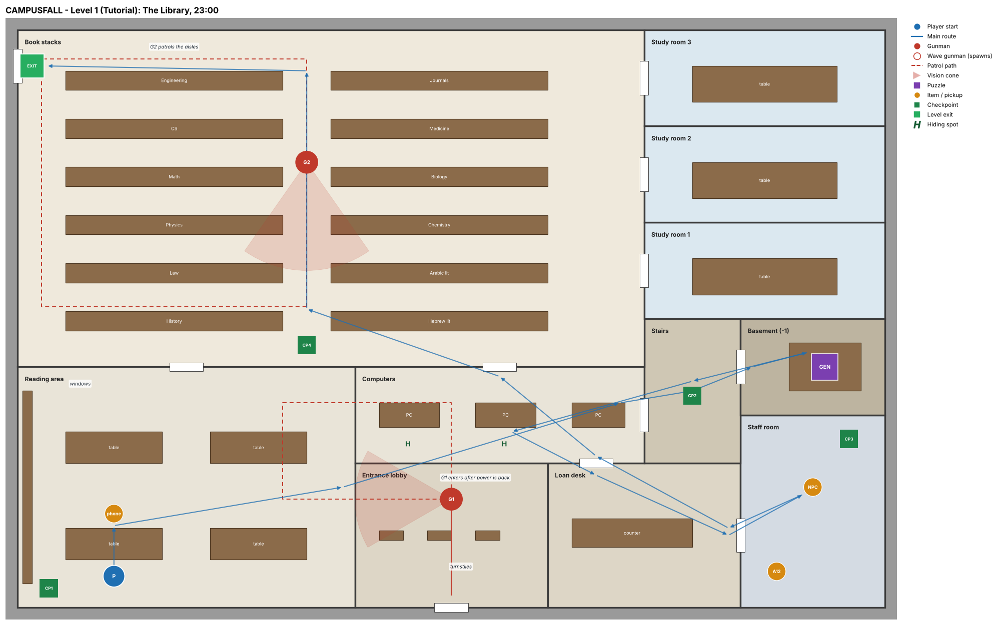
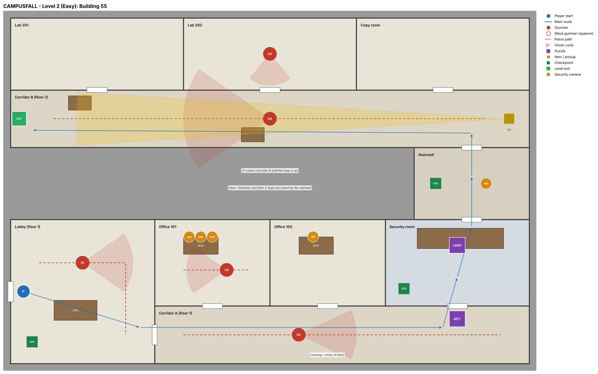
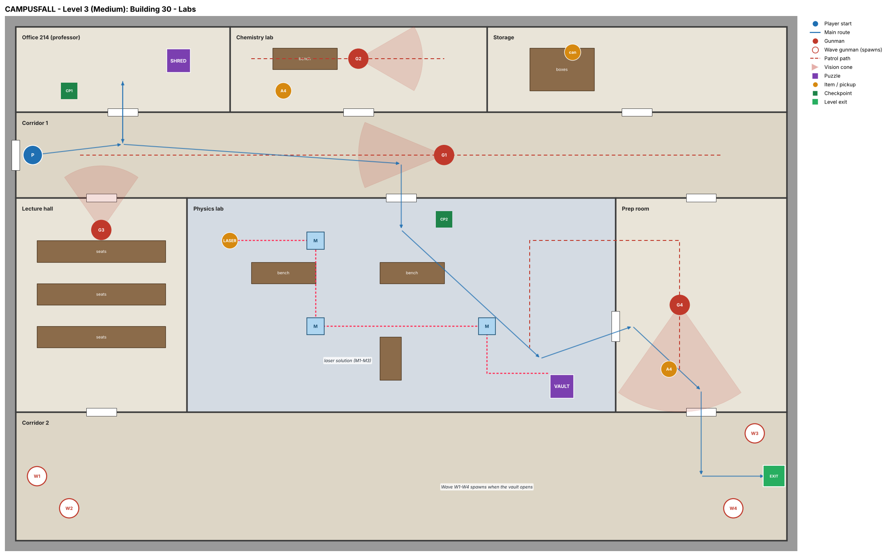
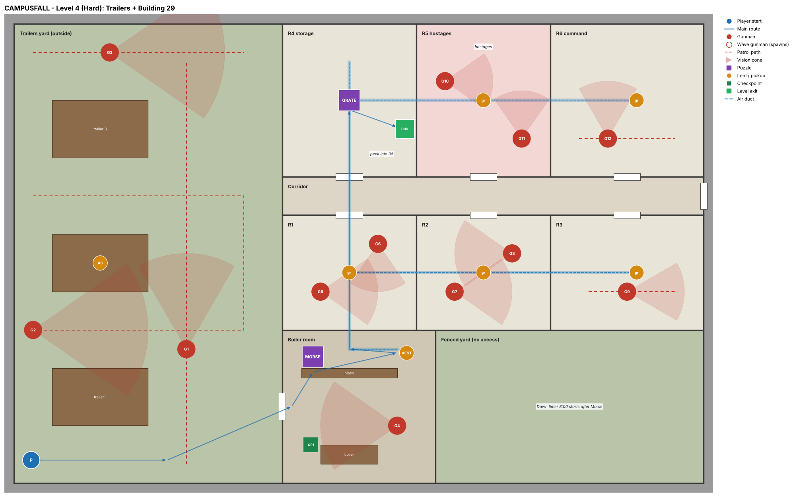

# CAMPUSFALL — תכנון רמות

**מטלה 3 - חלק א׳**

המסמך מתאר את 4 הרמות הראשונות של CAMPUSFALL: רמת הדרכה (Tutorial), רמה קלה, רמה בינונית ורמה קשה. לכל רמה יש תיאור של מה קורה בה מההתחלה ועד הסוף, פירוט של החידות ושל החמושים, ותרשים של המפה מלמעלה.

**הערה על התרשימים:** התרשימים מתארים את מבנה כל רמה ואת המשחקיות שלה: איפה השחקן עובר, איפה החמושים ואיפה החידות. הם עדיין לא העתק של הבניינים האמיתיים. במשחק עצמו המפות ייבנו לפי הבניינים בקמפוס אוניברסיטת אריאל, ויתעדכנו לפי תמונות ומדידות מהמקום.

**העיקרון שמנחה את כל הרמות:** כל רמה מלמדת דבר אחד חדש ומשתמשת בכל מה שהשחקן כבר למד. ה-Tutorial מלמד לשחק, הרמה הקלה מלמדת להתבונן בסביבה, הבינונית מוסיפה לחץ, והקשה מבקשת להקשיב ולקבל החלטות בלי לראות את כל התמונה.

| | 1 · Tutorial | 2 · קלה | 3 · בינונית | 4 · קשה |
|---|---|---|---|---|
| **מקום** | הספרייה | בניין 55 | בניין 30 | הקרוואנים ובניין 29 |
| **חמושים** | 2 | 5 | 8 | 12 |
| **תחמושת ברמה** | הרבה | מספיקה | מוגבלת | מעט מאוד |
| **לחץ זמן** | אין | אין | בחידה אחת | לכל המחצית השנייה |
| **נקודות שמירה** | 4 | 3 | 2 | 1 |
| **מה קורה כשטועים** | כלום, מנסים שוב | חמוש בא לבדוק | חמושים נוספים מגיעים | נתגלית, קרב תחת אש |

---

## רמה 1 · Tutorial · הספרייה, 23:00

### מבנה הספרייה
הספרייה בנויה כמו ספרייה אוניברסיטאית אמיתית:
- **לובי הכניסה:** דלתות זכוכית ושורת שערי כניסה (קרוסלות), כמו בכניסה לספרייה בקמפוס.
- **דלפק ההשאלה:** ליד הלובי. מאחוריו נמצא **חדר הצוות**, עם דלת חשמלית.
- **אזור הקריאה:** שולחנות ארוכים לאורך החלונות. כאן השחקן מתחיל.
- **עמדות המחשבים:** בין אזור הקריאה למדרגות.
- **אולם המדפים:** החלק הכי גדול בספרייה. 12 שורות מדפים לפי תחומים (מתמטיקה, פיזיקה, מדעי המחשב, משפטים, היסטוריה ועוד), עם מעברים צרים ביניהם.
- **3 חדרי לימוד** עם קירות זכוכית, לאורך הצד של אולם המדפים.
- **מדרגות למרתף:** שם נמצא הגנרטור.
- **יציאת חירום:** בקצה הרחוק של אולם המדפים.

### מה קורה ברמה
השעה 23:00, והשחקן לומד לבד ליד אחד השולחנות באזור הקריאה. הוא קם ולוקח את הטלפון שלו מהשולחן. ברגע שהוא אוסף אותו נשמעות יריות מבחוץ, החשמל נכבה, והכול נהיה חשוך. רק אור הירח נכנס מהחלונות.

השחקן מדליק את הפנס, וחץ על הרצפה מוביל אותו בין עמדות המחשבים אל המדרגות, ומשם למרתף. במרתף עומד גנרטור חירום ישן, וצריך להתניע אותו.

אחרי שהגנרטור נדלק, האורות חוזרים שורה אחרי שורה בכל הספרייה. השחקן עולה בחזרה, ובדיוק אז **חמוש ראשון נכנס דרך שערי הכניסה**. חץ אדום מסמן לשחקן להתחבא מתחת לאחד השולחנות של המחשבים. החמוש מסתובב בין אזור הקריאה לעמדות המחשבים כ-12 שניות, ויוצא חזרה ללובי.

עכשיו, כשיש חשמל, הדלת החשמלית של חדר הצוות שמאחורי דלפק ההשאלה נפתחת. בפנים שוכב מאבטח פצוע. הוא אומר לשחקן: **"הם לקחו סטודנטים לבניין 29. יציאת החירום בסוף המדפים"**, ונותן לו אקדח. בחדר יש גם תיבת תחמושת.

הדרך היחידה החוצה היא דרך **אולם המדפים**, אל יציאת החירום. בין המדפים מסייר חמוש שני, איטי. זה הקרב הראשון במשחק, והמדפים משמשים מחסה: אפשר לירות מקצה שורה ולהתחבא בחזרה מאחוריה. בסוף האולם נמצאת יציאת החירום, והרמה נגמרת.

### מה השחקן לומד, לפי הסדר
1. **לזוז** (בדרך לטלפון)
2. **לאסוף חפצים** (הטלפון)
3. **להשתמש בפנס** (בחושך)
4. **לתזמן לחיצה** (הגנרטור)
5. **להתחבא** (מהחמוש הראשון)
6. **לירות** (בחמוש השני)

כל דבר נלמד בנפרד, עם הודעה קצרה על המסך שמסבירה איזה מקש ללחוץ.

### המיני-משחק: התנעת הגנרטור ⚙️
מופיע מסך קרוב של הגנרטור. מתחתיו יש סקאלה, ומחוג שנע עליה הלוך ושוב. בסקאלה יש **אזור ירוק**, וצריך ללחוץ (רווח במחשב, נגיעה במסך בטלפון) כשהמחוג נמצא בתוכו.

- **בהתחלה המחוג איטי**, כדי שיהיה קל להבין מה עושים.
- **כל הצלחה:** השחקן מושך את החבל, יוצא עשן, המסך רועד, והמחוג **מאיץ**. המנוע משמיע צליל שונה בכל פעם: בפעם הראשונה הוא משתעל, בשנייה הוא מגמגם, ובשלישית הוא נדלק בשאגה.
- **פספוס:** החבל מחליק. **הספירה חוזרת להתחלה, והמחוג חוזר למהירות האיטית.**
- **צריך 3 הצלחות ברצף.** אין הגבלה על מספר הניסיונות.

### החמושים
- **החמוש הראשון** לא באמת מסוכן: הוא חלק מתסריט שמלמד להתחבא. אם הוא רואה את השחקן, אין Game Over. המשחק עוצר, מופיעה הודעה "התחבא!", והזמן חוזר כמה שניות אחורה.
- **החמוש השני** מסייר במעברים שבין המדפים, הולך לאט ויורה לאט. מספיקות 2 פגיעות כדי לנטרל אותו.

### למה הרמה קלה
כל יכולת נלמדת בנפרד, יש חצים שמראים לאן ללכת, ואין אפשרות להיכשל עד הקרב האחרון. וגם הקרב הוא נגד חמוש אחד איטי, עם הרבה תחמושת ו-4 נקודות שמירה לאורך הרמה. זה מתאים לקהל היעד מסקר השוק: שחקנים חובבים שבאים בשביל הסיפור, ולא שחקנים שרוצים אתגר קשה מהדקה הראשונה.

---

## רמה 2 · קלה · בניין 55

### מה קורה ברמה
השחקן נכנס ללובי של בניין 55. הוא יודע שבני הערובה בבניין 29, אבל לא יודע איך להגיע לשם בלי להיתפס. התשובה נמצאת **בחדר האבטחה** של הבניין, שבו יש מסכים של כל מצלמות הקמפוס.

בקומה הראשונה יש לובי, מסדרון ארוך ושני משרדים. במשרד אחד מחכות 3 פחיות על השולחן, ובשני יש תחמושת. חמושים מסיירים בלובי, במסדרון ובאחד המשרדים.

**הדבר החדש ברמה הוא רעש.** כשהשחקן רץ, החמושים בסביבה שומעים ובאים לבדוק. בפעם הראשונה שזה קורה מופיעה הודעה שמסבירה את זה. מצד שני, השחקן יכול לזרוק פחית לכיוון אחר, וכל החמושים שקרובים למקום שבו היא נוחתת הולכים לבדוק אותו. כך אפשר לפנות לעצמך את הדרך.

הדלת של חדר האבטחה נעולה במקלדת (**חידה 1**). בפנים, השחקן משתמש במערכת המצלמות כדי לעוור את המצלמה של הקומה השנייה (**חידה 2**). במסכים האחרים הוא רואה את בני הערובה מובלים לבניין 29, ושומע בקשר: **"הכרטיס הראשי בכספת בבניין 30"**.

עכשיו הוא עולה במדרגות לקומה השנייה. המסדרון שם ארוך, ומצלמה מכסה את כולו, אבל בזכות הלופ היא כבר לא רואה כלום. חמוש אחד עדיין מסייר בו, אז צריך לחכות שהוא יתרחק ולעבור. בקצה המסדרון יש גשר לבניין 30, והרמה נגמרת.

### חידה 1: טביעות אצבע 🔢
הדלת נעולה במקלדת עם 10 ספרות, והקוד הוא 4 ספרות. במבט רגיל המקלדת נראית נקייה, אבל **כשמאירים עליה בפנס** רואים ש-4 מקשים מבריקים משומן של אצבעות, וכל אחד בעוצמה אחרת.

**ההיגיון:** המקש הכי שחוק הוא זה שלוחצים עליו ראשון, כי האצבע עוברת עליו בכל פעם. לכן מקישים את המקשים לפי הסדר, מהכי מבריק להכי פחות מבריק. (**הקוד: 3-8-1-6**)

אם השחקן טועה, נשמע צפצוף. אחרי 3 טעויות הצפצוף מתחזק, והחמוש מהמסדרון בא לבדוק. זה לא Game Over, רק רעש שצריך להתמודד איתו.

### חידה 2: לולאת המצלמות 📹
על המסך הגדול רואים את ההקלטה של מצלמת הקומה השנייה מהדקה האחרונה, ומתחתיה **ציר זמן**. השחקן גורר את הסמן אחורה וקדימה, ורואה את החמוש זז במסדרון.

**המטרה:** למצוא קטע של **5 שניות לפחות שבו המסדרון ריק**, לסמן את ההתחלה והסוף שלו, ולהפעיל עליו לופ. מאותו רגע, מי שצופה במצלמה רואה רק מסדרון ריק.

בהקלטה יש שני קטעים שמתאימים. אם השחקן מסמן קטע שיש בו חמוש, מופיעה הודעה "הלופ חשוד, נסה שוב". אם הקטע קצר מדי, מופיעה הודעה "הקטע קצר מדי". אין עונש.

### החמושים
- **בקומה הראשונה, 3 חמושים:** אחד מסייר בלובי, אחד מסייר הלוך ושוב לאורך המסדרון, ואחד במשרד עם הפחיות. כולם הולכים במסלולים קבועים שקל ללמוד, ואפשר לעקוף אותם.
- **בקומה השנייה, 2 חמושים:** אחד מסייר לאורך המסדרון, ואחד עומד בכניסה לאחת המעבדות ומסתכל על הדלת.
- **המצלמה בקומה השנייה:** אם היא רואה את השחקן לפני שהפעיל את הלופ, שני החמושים בקומה עוברים למצב התראה.

### למה הרמה קלה
החמושים הולכים במסלולים קבועים, כל מה שצריך כדי לפתור את החידות נמצא באותו חדר, והטעויות לא עולות ביוקר. החידה הראשונה דורשת שלב אחד של היגיון, והשנייה שני שלבים. הדבר החדש היחיד הוא הרעש.

---

## רמה 3 · בינונית · בניין 30 – המעבדות

### מה קורה ברמה
השחקן מגיע לבניין המעבדות. הכרטיס הראשי נמצא בכספת במעבדת הפיזיקה, אבל הדלת שלה נעולה בקוד שאף אחד לא יודע.

הוא מתחיל במסדרון העליון. מצד אחד יש משרד של פרופסור, מעבדת כימיה ומחסן, ומהצד השני אולם הרצאות ומעבדת הפיזיקה. חמוש מסייר לאורך כל המסדרון, ועוד אחד במעבדת הכימיה. **החמוש שבאולם ההרצאות הוא סוג חדש:** אם הוא רואה את השחקן, הוא קורא בקשר, וכל החמושים בסביבה מגיעים.

במשרד הפרופסור יש מגרסת נייר (**חידה 1**). מהמסמך שבתוכה השחקן מגלה את הקוד של המעבדה ואיך לפתוח את הכספת. במעבדה מחכה **חידה 2**, הלייזר, עם טיימר.

כשהכספת נפתחת מופעלת **אזעקה**. אחרי כמה שניות **4 חמושים חדשים** מגיעים מהמסדרון התחתון, משני הצדדים. השחקן צריך לצאת דרך חדר ההכנה למסדרון התחתון, להילחם או לחמוק, ולהגיע ליציאה לבניין 29.

### חידה 1: המגרסה 📄
בסל של המגרסה יש **8 רצועות נייר**. השחקן גורר אותן ומסדר אותן אחת ליד השנייה, לפי רמזים:
- קו שממשיך מרצועה לרצועה
- חצי אות בקצה של רצועה, וההמשך שלה ברצועה אחרת
- כתם קפה עגול שמתחבר רק בסדר הנכון

כל זוג רצועות שמתחבר נכון "ננעל" במקום ומשמיע צליל, כך שהשחקן רואה שהוא מתקדם. כשכל הרצועות במקום, מתגלה **מכתב של הפרופסור**: "הקוד למעבדה: 7-3-0-5. אם משהו קורה, הכרטיס בכספת. הלייזר פותח אותה". מתחת יש שרטוט קטן של המעבדה עם 3 מראות. מהמכתב מבינים שגם הפרופסור הסתתר כאן מהחמושים.

### חידה 2: לייזר ומראות 🔦
במעבדת הפיזיקה יש מכשיר לייזר שיורה קרן אדומה, ויש 3 מראות על הרצפה. **כל לחיצה על מראה מסובבת אותה ברבע סיבוב.** צריך לסובב את המראות כך שהקרן תעבור מהמכשיר דרך כל המראות ותפגע בחיישן של הכספת. שולחן מעבדה גדול באמצע חוסם את הדרך הישירה, ולכן אי אפשר לדלג על אף מראה. (הפתרון מסומן בתרשים בקו אדום.)

**הטיימר:** מהרגע שהשחקן נוגע במראה הראשונה יש לו **60 שניות**, ואז החמוש שמסייר בחדר ההכנה חוזר למעבדה. אם הזמן נגמר, השחקן צריך להתחבא או להילחם. **המראות נשארות במקום שבו הוא השאיר אותן**, כך שהוא לא מאבד התקדמות.

### החמושים
- **4 חמושים ברמה מההתחלה:** אחד במסדרון העליון, אחד במעבדת הכימיה, אחד באולם ההרצאות (זה שקורא לעזרה), ואחד שמסייר בלולאה בין חדר ההכנה למעבדת הפיזיקה (זה שקובע את הטיימר).
- **4 חמושים בגל:** מופיעים כשהכספת נפתחת, ומתקדמים לעבר השחקן משני הצדדים של המסדרון התחתון.

### למה הרמה בינונית
החידות בנויות מכמה חלקים (8 רצועות, 3 מראות), יש לחץ זמן, ויש לראשונה טעויות עם מחיר אמיתי: חמוש שקורא לעזרה, וגל של אויבים. התחמושת מוגבלת, אז השחקן צריך לבחור מתי להילחם ומתי להתגנב. יש רק 2 נקודות שמירה.

---

## רמה 4 · קשה · הקרוואנים ובניין 29

### מה קורה ברמה
השחקן מגיע בלילה לחצר הקרוואנים שליד בניין 29. **זו לא הרמה האחרונה במשחק:** המטרה שלה היא למצוא איפה מחזיקים את בני הערובה ולהגיע אליהם בלי להתגלות. החילוץ עצמו מגיע ברמות הבאות.

**הדבר החדש ברמה הוא הקשבה.** החידות כאן נשמעות ולא נראות, והשחקן צריך לקבל החלטות בלי לראות את כל התמונה.

בחצר מסיירים 3 חמושים, ואם הם מבחינים בשחקן הם מחפשים אותו בזוגות ומנסים להקיף אותו מהצדדים. בין הקרוואנים אפשר להסתתר, ובתוך אחד מהם יש תחמושת.

השחקן נכנס לחדר הדוודים מהדלת האחורית. בפנים עומד חמוש שמסתכל לכיוון הדלת, ואפשר לזרוק פחית כדי שיסתובב. בחדר נשמעות **דפיקות מוזרות בצינורות** (**חידה 1**).

אחרי שהוא מפענח את הדפיקות, השחקן שומע בקשר של החמושים: **"מעבירים אותם עם הזריחה"**. מתחיל **טיימר של 8 דקות**. כדי לא לעבור במסדרונות המלאים בחמושים, השחקן נכנס לתעלת האוורור שבתקרת חדר הדוודים (**חידה 2**).

### חידה 1: הדפיקות בצינורות 🔊
בני הערובה דופקים על צינורות החימום **בקוד מורס**, בלי לדעת אם מישהו שומע. ההודעה חוזרת כל 20 שניות, ובכל דפיקה הצינור רועד ויוצאים ממנו אדים. על הקיר בחדר תלויה טבלת מורס: דפיקה קצרה היא נקודה, ודפיקה ארוכה היא קו.

השחקן מקשיב, כותב בפנקס על המסך את האותיות שהוא מזהה, ומגלה את ההודעה: **ROOM 5**. אחר כך הוא מסמן את החדר הזה במפה של הבניין.

**בונוס:** השחקן יכול לדפוק בחזרה "OK" במורס. בני הערובה עונים לו, וזה ישפיע על הסוף של המשחק.

### חידה 2: תעלות האוורור 🌬️
השחקן זוחל בתעלות שמעל החדרים של בניין 29. הזחילה איטית, ו**כל תנועה בתעלה נשמעת בחדר שמתחת**. כשהוא עוצר, השקט חוזר.

אם חמוש שעומד ממש מתחת שומע אותו, הוא מסתכל למעלה ומעליו מופיע סימן שאלה שמתמלא לאט. אם השחקן עוצר בזמן, החמוש מוותר. אם הוא ממשיך לזחול, הוא מתגלה, והחמוש יורה דרך התקרה. השחקן צריך לברוח אחורה בתעלה.

**בתעלות יש 6 סורגים**, אחד מעל כל חדר, ודרך כל סורג אפשר להציץ ולראות מי נמצא בחדר שמתחת. השחקן צריך למצוא **חדר ריק שצמוד לחדר 5**. זה המחסן. אם הוא קופץ לחדר אחר, הוא נוחת בין חמושים ומתחיל קרב קשה.

**הסוף:** השחקן יורד למחסן ומציץ דרך סדק בקיר לחדר 5. הוא רואה 4 בני ערובה ואת השומרים שלהם, ועל המסך מופיע **"המשך יבוא"**.

### החמושים
- **בחצר, 3 חמושים:** מסיירים ורואים רחוק. במצב התראה הם מחפשים בזוגות ומאגפים.
- **בחדר הדוודים, חמוש אחד:** עומד ומסתכל לכיוון הדלת. אפשר להסיח אותו בפחית.
- **בחדרים שמתחת לתעלה, 6 חמושים:** בשלושת החדרים הראשונים ובחדר הפיקוד. רובם עומדים, וכולם שומעים את התעלה.
- **בחדר 5, 2 חמושים:** השומרים של בני הערובה. ברמה הזו לא נלחמים בהם.

**אם הטיימר מגיע לאפס, בני הערובה מועברים. זה Game Over.**

### למה הרמה קשה
יש הכי הרבה חמושים, הכי מעט תחמושת ונקודת שמירה אחת בלבד. יש טיימר על כל החלק השני של הרמה, והחמושים מחפשים את השחקן באופן פעיל. שתי החידות מבוססות על שמיעה ועל החלטות בלי מידע מלא: לפענח הודעה מדפיקות, ולבחור לאיזה חדר לקפוץ לפי הצצות קצרות.

---

## הקשר לסקר השוק

| ממצא מסקר השוק | איך הוא משפיע על הרמות |
|---|---|
| קהל היעד (18–35) מגיע בשביל **סיפור** | בכל רמה יש רגע סיפור שמקדם את העלילה: המאבטח הפצוע, המסכים, המכתב של הפרופסור, הדפיקות של בני הערובה |
| שבחו את SIGNALIS על **חידות נגישות** | כל חידה עובדת לפי חוקים ברורים, ואין בה ניחושים |
| התלונה על The Coma: **מפות מבלבלות והליכה מיותרת** | המפות קטנות, והרמזים תמיד נמצאים קרוב לחידה |
| **התגנבות** מצליחה בנישה | בכל רמה אפשר לעקוף חמושים, ולא רק להילחם |
| הגיבור **מציל ולא תוקף** | המטרה בכל רמה קשורה לבני הערובה, לא להרג |

